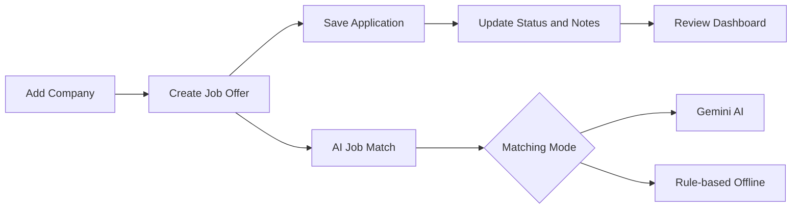
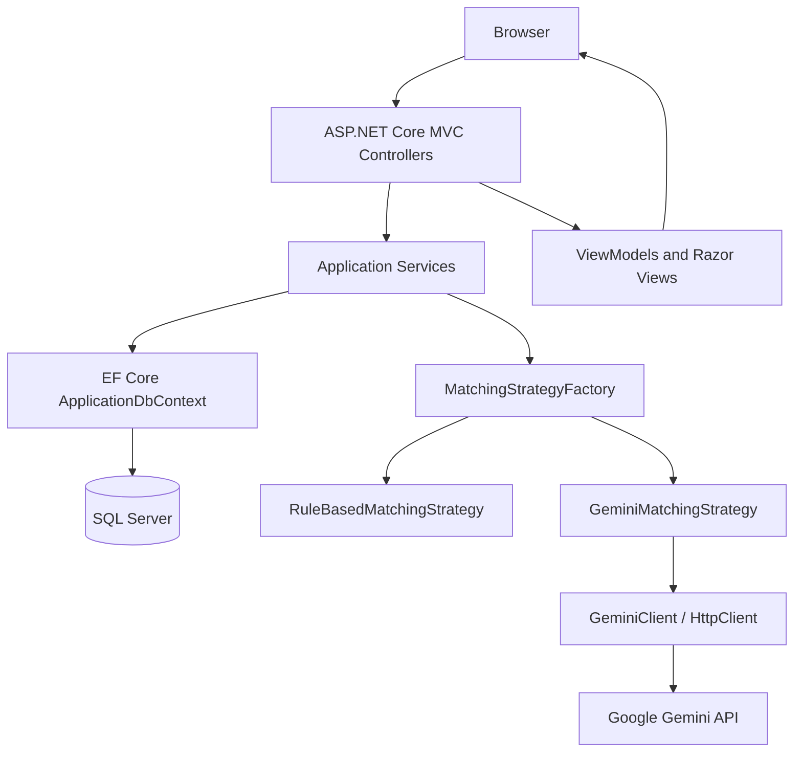
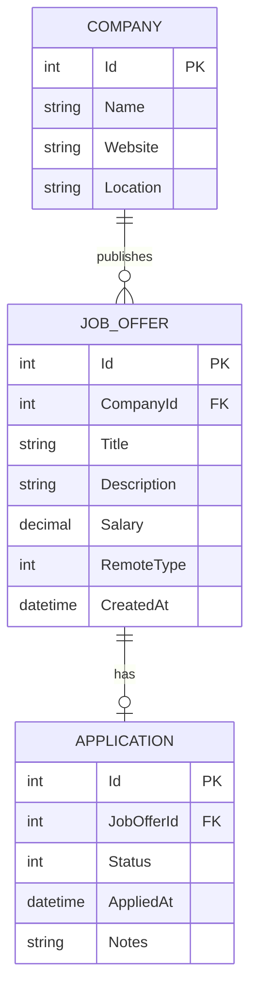
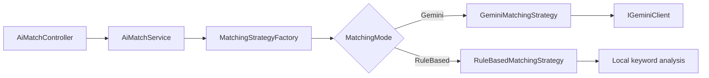

<div align="center">

# 💼 JobTracker

### Organize your job search. Track every application. Discover how well you match.

<p>
  
  
  
  
  
  
  
</p>

<p>
  <strong>6 MVC controllers</strong> &nbsp;·&nbsp;
  <strong>3 database entities</strong> &nbsp;·&nbsp;
  <strong>3 design patterns</strong> &nbsp;·&nbsp;
  <strong>AI-powered matching</strong>
</p>

**An ASP.NET Core MVC coursework project by Team 2 (ST2 — 2026).**

</div>

---

> **TL;DR** — **JobTracker** is a web application for organizing a personal job search. It centralizes **companies, job offers, and applications**, supports database-backed **CRUD operations**, searching, filtering, and pagination, and presents a **dashboard** with application statistics. Its **AI Job Match** feature compares a candidate's skills and experience against a saved vacancy using either **Google Gemini** or an **offline, rule-based algorithm**. The solution is built with **ASP.NET Core MVC (.NET 10), Entity Framework Core, SQL Server, Razor Views, and Bootstrap**.

---

## 📑 Table of Contents

- [Overview](#-overview)
- [Key Features](#-key-features)
- [Application Workflow](#-application-workflow)
- [Technology Stack](#-technology-stack)
- [Architecture](#-architecture)
- [Data Model](#-data-model)
- [Design Patterns](#-design-patterns)
- [AI Job Match](#-ai-job-match)
- [Project Structure](#-project-structure)
- [Getting Started](#-getting-started)
- [Using the Application](#-using-the-application)
- [Validation & Business Rules](#-validation--business-rules)
- [Testing](#-testing)
- [Coursework Requirements](#-coursework-requirements)
- [Limitations & Future Work](#-limitations--future-work)
- [References](#-references)
- [Project Team](#-project-team)

---

## 🎯 Overview

Keeping track of a job search becomes difficult when information is scattered across job boards, bookmarks, notes, and emails. A single candidate may follow multiple companies, compare several vacancies, and move through different stages of recruitment at the same time.

**JobTracker** brings that information together in a structured application. Its purpose is to help users:

1. **Register companies** they are interested in, including website and location.
2. **Save job offers** with descriptions, salaries, locations, and work arrangements.
3. **Track applications** and their current recruitment status.
4. **Search and filter records** instead of browsing unorganized lists.
5. **Monitor progress** through dashboard metrics and recently added applications.
6. **Evaluate a potential fit** between their profile and a selected vacancy using Gemini AI or offline matching.

The project emphasizes separation of concerns, relational database design, MVC validation, dependency injection, asynchronous data access, and explicitly implemented **Singleton, Strategy, and Factory** design patterns.

> **Scope:** JobTracker is a **manual job-search tracker**. It does not automatically scrape vacancies from external job boards or submit applications on a user's behalf.

---

## ✨ Key Features

| Module | Capabilities |
|---|---|
| **🏢 Companies** | Create, view, update, and delete companies; store website and location; filter by name/location; paginate results. |
| **📋 Job Offers** | Full CRUD; associate each vacancy with a company; record title, description, location, salary, remote-work type, and creation date; search and filter by multiple criteria. |
| **📨 Applications** | Full CRUD; associate an application with one vacancy; track status, submission date, and notes; filter by job title, company, and status. |
| **📊 Dashboard** | Show totals for companies, vacancies, and applications; count offers without applications; visualize status distribution; display the five most recently added applications. |
| **🤖 AI Job Match** | Compare a candidate profile against a saved job offer using a real Gemini API request or an offline rule-based strategy; present a score, summary, matched/missing skills, and recommendations. |
| **🏠 Home** | Landing page with navigation and shortcuts to core workflows. |

### Interface highlights

- Server-rendered **Razor Views** with a shared layout.
- **Bootstrap 5.3.3** styling, responsive forms, tables, navigation, and progress indicators.
- **Search filters and server-side pagination** with a default page size of **10**.
- **Data Annotations**, model-state checks, and jQuery unobtrusive validation.
- Dedicated create, edit, and delete-confirmation pages for CRUD modules.
- Success messages following completed changes; safe handling of missing or dependent records.
- Clearly labeled AI and offline analysis results.

---

## 🔄 Application Workflow

The main user journey follows the relationships between companies, vacancies, and applications:



### Application statuses

The `ApplicationStatus` enum defines five available statuses:

| Status | Meaning |
|---|---|
| `Saved` | The vacancy has been saved, but no application date is recorded. |
| `Applied` | An application has been submitted. |
| `Interview` | The recruitment process has reached an interview stage. |
| `Offer` | An employment offer has been received. |
| `Rejected` | The application has been rejected. |

**Important:** These are selectable statuses, **not a strictly enforced transition state machine**. The current editing interface allows the user to update a status directly, subject to validation rules.

An application in `Saved` status **cannot have an `AppliedAt` value**. For other statuses, if no date is supplied, the application records the current UTC time. When editing an existing application, an unchanged calendar date preserves its original time component.

### Relationship and deletion rules

- One **company** can have many job offers.
- Each **job offer** belongs to one company.
- A **job offer can have at most one application** in the current data model.
- Companies with existing job offers cannot be deleted until those offers are reassigned or removed.
- Job offers with an associated application cannot be deleted until the application is removed.
- The UI uses confirmation pages and appropriate database restrictions to prevent accidental dependent-record deletion.

---

## 🛠️ Technology Stack

| Layer | Technology |
|---|---|
| Programming language | **C#** |
| Framework | **.NET 10**, **ASP.NET Core MVC** |
| UI | **Razor Views**, HTML, CSS, **Bootstrap 5.3.3** |
| Client-side libraries | **jQuery 3.7.1**, jQuery Validation, jQuery Unobtrusive Validation |
| Data access | **Entity Framework Core 10.0.13**, LINQ |
| Database | **Microsoft SQL Server / SQL Server Express** |
| Database provider | `Microsoft.EntityFrameworkCore.SqlServer` |
| Application configuration | `appsettings.json`, environment variables, **.NET User Secrets** |
| External AI | **Google Gemini API** through a typed `HttpClient` |
| Dependency injection | Built-in ASP.NET Core DI container |
| Automated tests | **xUnit**, `Microsoft.AspNetCore.Mvc.Testing`, **SQLite in-memory** |
| Development tools | **Visual Studio** or VS Code, **.NET CLI**, SQL Server tools |

The application references EF Core tooling for schema migrations. Its test project uses a separate SQLite relational database and test-specific configuration rather than modifying the local SQL Server database.

---

## 🧱 Architecture

JobTracker follows the **Model–View–Controller (MVC)** pattern and uses a dedicated service layer to keep persistence and business operations separate from HTTP request handling.



**Component responsibilities**

- **Controllers** — handle routes, form submissions, MVC validation, redirects, and HTTP results.
- **Services and interfaces** — implement CRUD queries, filtering, business checks, dashboard statistics, and matching coordination.
- **Entities** — represent persisted companies, job offers, and applications.
- **ViewModels** — model forms, lists, filters, dashboard summaries, and AI matching input/output.
- **`ApplicationDbContext` and EF configurations** — manage database access, constraints, relationships, seeding, and migrations.
- **Design-pattern implementations** — select a matching algorithm without hard-coding the implementation into the controller.
- **Views and static assets** — render the HTML interface and associated client-side resources.

Services are registered in `Program.cs` via dependency injection. CRUD services and matching services have scoped lifetimes, while the shared `ApplicationSettings` instance is registered as a singleton.

---

## 🗄️ Data Model

The SQL Server database contains **three domain entities**:

| Entity | Key fields | Purpose |
|---|---|---|
| `Company` | `Id`, `Name`, `Website`, `Location` | Represents an employer and its saved vacancies. |
| `JobOffer` | `Id`, `CompanyId`, `Title`, `Description`, `Location`, `Salary`, `RemoteType`, `CreatedAt` | Represents a job vacancy associated with a company. |
| `Application` | `Id`, `JobOfferId`, `Status`, `AppliedAt`, `Notes` | Represents an application for one vacancy. |



### Database integrity

- The `CompanyId` foreign key links each job offer to its company.
- The `JobOfferId` foreign key links each application to its job offer.
- A **unique index on `Applications.JobOfferId`** enforces at most one application per job offer.
- Foreign keys use **restrict** delete behavior to preserve referenced records.
- EF Core Fluent API configurations define required properties, maximum lengths, and salary precision (`decimal(12,2)`).
- Asynchronous queries use `AsNoTracking()` where appropriate, and filtered lists are paginated in the database.

### Initial sample records

Applying the included **`InitialCommit` migration** creates the schema and inserts demonstration data:

| Table | Seed records |
|---|---:|
| `Companies` | 3 |
| `JobOffers` | 3 |
| `Applications` | 3 |

The sample data includes **TechNova Solutions**, **CodeBridge**, and **Digital Horizon**, together with Junior .NET Developer, Junior Python Developer, and Frontend React Developer opportunities.

> The sample records are part of the EF Core migration (`HasData` / `InsertData`). They are **not reinserted automatically on every application startup**.

---

## 🧩 Design Patterns

Three explicit design patterns are implemented under `DesignPatterns/` and integrated with the application's dependency injection setup.

### 1. Singleton — `ApplicationSettings`

**Location:** [`DesignPatterns/Singleton/ApplicationSettings.cs`](ST2-2026-Team-2-JobTracker/DesignPatterns/Singleton/ApplicationSettings.cs)

**Purpose:** Provide one shared settings object across the application.

- Uses a private constructor and `Lazy<ApplicationSettings>` for lazy, thread-safe initialization.
- Exposes its instance through `ApplicationSettings.Instance`.
- Provides the application name (`JobTracker`) and the default pagination size (`10`).
- Is registered with ASP.NET Core DI as `AddSingleton(ApplicationSettings.Instance)`.
- Is injected into CRUD controllers for shared pagination and application settings.

**Why it fits:** One central configuration instance prevents controllers from creating inconsistent copies of shared settings.

### 2. Strategy — interchangeable matching algorithms

**Locations:**

- [`DesignPatterns/Strategy/IMatchingStrategy.cs`](ST2-2026-Team-2-JobTracker/DesignPatterns/Strategy/IMatchingStrategy.cs)
- [`DesignPatterns/Strategy/GeminiMatchingStrategy.cs`](ST2-2026-Team-2-JobTracker/DesignPatterns/Strategy/GeminiMatchingStrategy.cs)
- [`DesignPatterns/Strategy/RuleBasedMatchingStrategy.cs`](ST2-2026-Team-2-JobTracker/DesignPatterns/Strategy/RuleBasedMatchingStrategy.cs)

**Purpose:** Execute the same matching use case using different algorithms behind a common interface.

| Strategy | Implementation | Requires an API key? |
|---|---|---|
| `GeminiMatchingStrategy` | Calls `IGeminiClient` to obtain a model-generated assessment. | **Yes** |
| `RuleBasedMatchingStrategy` | Compares a curated set of technology keywords from the job description and candidate profile. | **No** |

Both implement `IMatchingStrategy.MatchAsync(...)`, returning a common `MatchingResult` object. The strategy can be changed without rewriting the AI Match controller.

### 3. Factory — `MatchingStrategyFactory`

**Location:** [`DesignPatterns/Factory/MatchingStrategyFactory.cs`](ST2-2026-Team-2-JobTracker/DesignPatterns/Factory/MatchingStrategyFactory.cs)

**Purpose:** Select the appropriate strategy for the user's chosen matching mode.

- Receives all registered `IMatchingStrategy` implementations from the DI container.
- Maps each implementation to its `MatchingMode` value.
- Resolves the selected implementation through `Create(MatchingMode mode)`.
- Throws `ArgumentOutOfRangeException` for unsupported modes.
- Is used by `AiMatchService`, keeping the controller independent of concrete matching classes.

> This is a **strategy-selection factory**: the strategies themselves are created by dependency injection; the factory selects the appropriate registered instance.

### Pattern collaboration



The implementation illustrates both **extensibility** (new matching algorithms can implement the interface) and **testability** (matching logic can be verified independently of the MVC UI).

---

## 🤖 AI Job Match

The AI Job Match page (`/AiMatch`) helps a candidate evaluate how their skills and experience align with a **job offer already stored in JobTracker**.

### Inputs and outputs

**Inputs**

1. A selected job offer from the database.
2. A free-text description of the candidate's skills and experience (**15–3,000 characters**).
3. One of two matching modes: **Gemini AI** or **Rule-based (offline)**.

**Outputs**

- An approximate **match score from 0 to 100**.
- A concise assessment summary.
- A list of matching technologies or skills.
- A list of missing technologies or skills.
- Practical recommendations for improvement.
- An explicit source label identifying the matching mode used.

> The score is **indicative only**. It is not a hiring prediction or a probability of receiving an offer.

### Gemini AI mode

`GeminiMatchingStrategy` delegates to [`GeminiClient`](ST2-2026-Team-2-JobTracker/Services/AI/GeminiClient.cs), a typed HTTP client that:

1. Retrieves the selected job's title, description, and company from the database.
2. Combines that information with the candidate profile in a structured prompt.
3. Calls the Google Gemini **`generateContent`** endpoint over HTTPS.
4. Supplies the API key in the `x-goog-api-key` **request header**, not in the URL.
5. Requests structured **JSON output** with a score, summary, skills, and recommendations.
6. Validates the returned data, normalizes list items, and displays the result in a Razor View.

The client provides user-friendly messages for missing credentials, invalid provider responses, timeouts, connectivity problems, rate limits, and unavailable models. Model-generated text is rendered through Razor's usual HTML encoding.

**Data-sharing note:** Gemini mode transmits the selected vacancy details and the candidate's entered profile to Google's external service. Do not paste credentials or sensitive personal information into the profile field. The current application does **not** save analysis results in its database.

### Rule-based offline mode

`RuleBasedMatchingStrategy` works **without Gemini credentials or an internet connection to the AI provider**. It detects a predefined list of technologies (for example C#, ASP.NET Core, SQL Server, Python, React, Docker, and Git) in the vacancy and in the candidate profile.

Its approximate score is calculated as:

```text
Score = 100 × (Recognized required technologies also in the profile)
              / (Recognized required technologies in the vacancy)
```

The score is rounded to an integer. If the description contains **no supported technology keywords**, the strategy returns a score of `0` and explains that the result is not informative. This mode is deterministic keyword matching; **it is not a language model**.

### Example matching scenario

For the provided **Junior .NET Developer** vacancy, a candidate can enter:

```text
I have experience with C#, ASP.NET Core MVC, SQL Server,
Entity Framework Core, and Git through personal projects.
```

After selecting either matching mode and clicking **Analyze Match**, the page presents the score and associated feedback. The two modes can produce different assessments because they use fundamentally different algorithms.

---

## 📁 Project Structure

```text
ST2-2026-Team-2-JobTracker-main/
│
├── ST2-2026-Team-2-JobTracker.slnx       # Solution file
├── NuGet.Config                          # NuGet package source
├── JobTracker.Tests/                     # xUnit test project
│   ├── AiMatchTests.cs
│   ├── CrudTests.cs
│   ├── DashboardTests.cs
│   ├── RegressionTests.cs
│   └── JobTracker.Tests.csproj
│
├── ST2-2026-Team-2-JobTracker/           # ASP.NET Core MVC project
│   ├── Common/
│   │   ├── Constants/ValidationConstants.cs
│   │   └── Helpers/TextNormalization.cs
│   ├── Controllers/                      # Six MVC controllers
│   │   ├── HomeController.cs
│   │   ├── CompaniesController.cs
│   │   ├── JobOffersController.cs
│   │   ├── ApplicationsController.cs
│   │   ├── DashboardController.cs
│   │   └── AiMatchController.cs
│   ├── Data/
│   │   ├── Configurations/               # EF Core entity configurations and seed data
│   │   └── ApplicationDbContext.cs
│   ├── DesignPatterns/
│   │   ├── Singleton/
│   │   ├── Strategy/
│   │   └── Factory/
│   ├── Migrations/                        # Initial database migration and snapshot
│   ├── Models/
│   │   ├── Entities/                     # Company, JobOffer, Application
│   │   ├── Enums/                        # Status, remote-work type, matching mode
│   │   ├── AI/                           # Matching input and result
│   │   └── ViewModels/                   # Form, filter, dashboard, and AI models
│   ├── Services/
│   │   ├── Interfaces/                   # Service contracts
│   │   ├── AI/                           # Gemini HTTP integration and options
│   │   ├── CompanyService.cs
│   │   ├── JobOfferService.cs
│   │   ├── ApplicationService.cs
│   │   ├── DashboardService.cs
│   │   └── AiMatchService.cs
│   ├── Views/                             # Razor pages and shared UI
│   ├── wwwroot/                           # CSS, JavaScript, Bootstrap, jQuery
│   ├── Properties/launchSettings.json    # Local launch profiles
│   ├── appsettings.json                  # SQL Server and Gemini configuration
│   ├── appsettings.Development.json
│   ├── Program.cs                        # Service registration and HTTP pipeline
│   └── ST2-2026-Team-2-JobTracker.csproj
│
├── .gitignore
└── README.md
```

---

## 🚀 Getting Started

The checked-in configuration targets **Windows development with SQL Server Express**, using a `SQLEXPRESS` instance and Windows authentication. If you use a different database server, override the connection string as described below.

### 1. Prerequisites

- **.NET 10 SDK** — [Download](https://dotnet.microsoft.com/en-us/download/dotnet/10.0)
- **SQL Server Express** or another accessible SQL Server instance — [Download](https://www.microsoft.com/en-us/sql-server/sql-server-downloads)
- **Git** (if cloning the repository) — [Download](https://git-scm.com/downloads)
- **EF Core CLI** (`dotnet-ef`) for applying migrations
- **Visual Studio** / VS Code and **SQL Server Management Studio (SSMS)** are optional but useful.
- A **Google Gemini API key** is necessary **only for Gemini AI mode**. Offline matching works without it.

> The supplied connection string uses **Windows integrated authentication**. Ensure that the Windows account running the commands has the required SQL Server permissions.

### 2. Open the solution directory

Download or clone the project repository, then open a terminal in the root directory — the one containing `ST2-2026-Team-2-JobTracker.slnx`.

```powershell
cd ST2-2026-Team-2-JobTracker-main
```

If your directory name differs (for example, because the repository was cloned instead of extracted from a ZIP), use the actual directory name.

### 3. Restore NuGet dependencies

```powershell
dotnet restore ST2-2026-Team-2-JobTracker.slnx
```

### 4. Configure SQL Server

The default connection string in `ST2-2026-Team-2-JobTracker/appsettings.json` is:

```json
{
  "ConnectionStrings": {
    "DefaultConnection": "Server=.\\SQLEXPRESS;Database=JobTrackerDb;Trusted_Connection=True;TrustServerCertificate=True;MultipleActiveResultSets=true"
  }
}
```

Make sure the local `SQLEXPRESS` instance is running. To use a different instance or database, update your **local** configuration or supply the connection string via an environment variable.

For example, in **PowerShell**:

```powershell
$env:ConnectionStrings__DefaultConnection = 'Server=.\SQLEXPRESS;Database=JobTrackerDb;Trusted_Connection=True;TrustServerCertificate=True;MultipleActiveResultSets=true'
```

Adjust the server and authentication settings for your installation. **Do not commit database credentials or secrets.** `TrustServerCertificate=True` is suitable for this local-development example, not for a hardened production deployment.

### 5. Apply the existing EF Core migration

Install the matching EF Core command-line tool if it is not already available:

```powershell
dotnet tool install --global dotnet-ef --version 10.0.13
```

From the solution root, navigate to the MVC project directory and apply the existing migration:

```powershell
cd ST2-2026-Team-2-JobTracker
dotnet ef database update
```

This creates/updates the `JobTrackerDb` database and applies the initial sample records.

> **Do not run `dotnet ef migrations add InitialCommit`.** The repository already contains the initial migration (`20261011174444_InitialCommit`). The `database update` command applies it.

### 6. Configure Gemini (optional)

The project already declares a **User Secrets ID**. From the **MVC project directory**, add your key:

```powershell
dotnet user-secrets set "Gemini:ApiKey" "YOUR_GEMINI_API_KEY"
```

Replace `YOUR_GEMINI_API_KEY` with your own key. User Secrets are intended for **local development** and keep the key out of tracked source files.

The checked-in `appsettings.json` selects the following Gemini configuration:

```json
{
  "Gemini": {
    "BaseUrl": "https://generativelanguage.googleapis.com/",
    "Model": "gemini-3.5-flash-lite"
  }
}
```

**Check model access:** The example model name is the value present in the submitted project; this documentation does **not** verify its current availability for your API account. If the provider reports a missing or unsupported model, configure `Gemini:Model` to a model you can access. The fallback value inside `GeminiOptions.cs` differs from the checked-in JSON value; **the JSON configuration takes precedence**.

Alternatively, provide the key through the `Gemini__ApiKey` environment variable. **Never put the real key in `appsettings.json`, screenshots, or committed code.**

### 7. Run the application

Still inside `ST2-2026-Team-2-JobTracker/`, execute:

```powershell
dotnet run --launch-profile https
```

Open **https://localhost:7127** in a browser. The supplied profiles also expose **http://localhost:5057** for local development.

If the development HTTPS certificate is not trusted, run:

```powershell
dotnet dev-certs https --trust
```

Alternatively, open `ST2-2026-Team-2-JobTracker.slnx` in Visual Studio and launch the MVC project with the **https** profile.

---

## 🖥️ Using the Application

The initial URL loads the **Home** page. The main navigation links to **Companies**, **Job Offers**, **Applications**, **Dashboard**, and **AI Match**.

### A typical job-search scenario

1. Open **Companies** and create a record for an employer.
2. Open **Job Offers** and add a vacancy associated with that company.
3. Specify its title, description, optional salary, location, and work arrangement (`OnSite`, `Hybrid`, or `Remote`).
4. Open **Applications**, select the vacancy, and create an application with an initial status and optional notes.
5. Change the application status as your recruitment process advances.
6. Open **Dashboard** to review totals, status distribution, and the most recently added applications.
7. Open **AI Match**, choose a saved vacancy, enter your skills, and analyze it in Gemini or Rule-based mode.

### Search and filtering

| Area | Available filters |
|---|---|
| Companies | Company name, location |
| Job Offers | Title, company, location, remote-work type, minimum salary, maximum salary |
| Applications | Job title, company, application status |

All three list pages paginate their results, with **10 records per page** by default.

### Example routes

| Page | Route |
|---|---|
| Home | `/` |
| Companies | `/Companies` |
| Job Offers | `/JobOffers` |
| Applications | `/Applications` |
| Dashboard | `/Dashboard` |
| AI Job Match | `/AiMatch` |

---

## 🛡️ Validation & Business Rules

JobTracker combines **Data Annotations**, normalized form input, controller-level business checks, and relational database constraints.

- **Companies:** name is required (2–150 characters), website must be a valid URL when provided, and optional location length is limited.
- **Job Offers:** title (3–150 characters) and description (10–10,000 characters) are required; company selection must be valid; salary is optional but validated when entered; work type must be a recognized enum value.
- **Applications:** the selected vacancy must exist and must not already have an application; notes are limited to 2,000 characters; `Saved` cannot have an application date.
- **AI Match:** an existing vacancy must be selected; the candidate profile must contain 15–3,000 characters; the selected mode must be valid.
- **Search filters:** invalid enum, company, or salary range values produce validation messages instead of misleading search results.
- **Input normalization:** required and optional text values are trimmed before validation and persistence.
- **Delete safety:** linked companies and vacancies are protected by service checks and restrictive foreign keys.
- **Concurrency/error handling:** controllers handle relevant EF Core update failures with user-facing error messages.
- **Anti-forgery protection:** state-changing MVC POST actions use `[ValidateAntiForgeryToken]`.

The application uses standard Razor HTML encoding when rendering user-entered data and AI output. These measures are appropriate for the current coursework scope but do **not** replace authentication, authorization, or a comprehensive production-security review.

---

## 🧪 Testing

The repository includes the **`JobTracker.Tests`** project, using **xUnit** and ASP.NET Core's `WebApplicationFactory` for application-level tests.

| Test file | Primary coverage |
|---|---|
| `CrudTests.cs` | Creating, editing, deleting, validation, dependency restrictions, and anti-forgery protection. |
| `RegressionTests.cs` | Previously identified CRUD, date-handling, filtering, normalization, and pagination edge cases. |
| `DashboardTests.cs` | Dashboard pages, statistics, status counts, recent applications, and empty-data behavior. |
| `AiMatchTests.cs` | Matching page, offline analysis, validation, strategy selection, and Gemini configuration/error handling. |

Tests use a **separate SQLite in-memory database** configured through `WebApplicationFactory`. Gemini HTTP behavior is tested with a **stubbed HTTP handler**; these tests do not need a real Gemini key or a live API request.

From the **solution root**, run:

```powershell
dotnet test ST2-2026-Team-2-JobTracker.slnx
```

> **Known test-maintenance issue in the provided snapshot:** Some assertions in `RegressionTests.cs` and `DashboardTests.cs` expect the navigation **not** to link to `/Dashboard` or `/AiMatch`. However, the current shared layout intentionally includes both pages. Update those obsolete assertions before expecting the entire suite to pass. **The test suite has not been executed as part of preparing this README**, so no green-build claim is made here.

---

## 🎓 Coursework Requirements

The implementation directly addresses the five stated assignment requirements:

| Requirement | Implementation in JobTracker | Status in source code |
|---|---|---|
| **1. MVC architecture** | ASP.NET Core MVC with controllers, models, views, ViewModels, and services. | ✅ Implemented |
| **2. At least 5 controllers/views** | **6 MVC controllers**: Home, Companies, JobOffers, Applications, Dashboard, AiMatch; each has a corresponding view area. | ✅ Implemented |
| **3. At least 3 documented design patterns** | **Singleton**, **Strategy**, and **Factory** in `DesignPatterns/`, with separation of responsibilities and usage in DI. | ✅ Implemented; expand the Singleton's in-code comments if required by grading criteria |
| **4. Database CRUD** | Full Create/Read/Update/Delete for **companies, job offers, and applications** through EF Core + SQL Server. | ✅ Implemented |
| **5. Communication with a language model** | `GeminiClient` makes an HTTP request to the Google Gemini `generateContent` API; offline mode is a separate non-LLM option. | ✅ Integration implemented; live access requires a valid API key and supported model |

**Assessment note:** This table reflects the inspected source implementation. Successful operation with a local SQL Server installation and a real Gemini account should be demonstrated before final submission.

---

## 🔭 Limitations & Future Work

### Current limitations

- **No authentication or authorization:** the application does not separate data by account, user, or role.
- **No automatic job import or submission:** all job offers and applications are entered and maintained manually.
- **At most one application per job offer:** enforced by the domain model and a unique database index.
- **No strict application-status transition workflow:** users can directly select statuses; an audit trail of transitions is not stored.
- **AI analyses are not persisted** in the database; refreshing or leaving the result page does not provide a history of previous assessments.
- **Rule-based matching has limited vocabulary:** only recognized technology names contribute to its score.
- **Gemini requires working credentials, network connectivity, quota, and access to the configured model**; the provider can return errors or variable responses.
- **Local SQL Server configuration:** production deployment, hardened secret management, monitoring, and external hosting are not included.
- **Stale navigation assertions** in two test files need updating to match the implemented Dashboard and AI Match links.

### Suggested next improvements

1. **Finalize validation and testing:** update outdated test assertions, run the full suite, and verify manual CRUD and dashboard scenarios.
2. **Validate the live Gemini integration:** confirm the configured model is available, test a real API call, and document any model/configuration changes.
3. **Improve design-pattern comments:** add an explicit XML documentation summary to `ApplicationSettings` and document the intent of each pattern directly in code.
4. **Introduce user accounts and authorization:** isolate each user's companies, vacancies, and applications.
5. **Add application history and more analytics:** store status-change events, add timeline charts, and support export/reporting.
6. **Extend AI Match:** optionally store analyses, support CV text extraction, and add more matching strategies or configurable skill vocabularies.
7. **Prepare for production deployment:** secure configuration, structured logging, CI, database backups, and hosting documentation.

These features are opportunities for future development, **not claims about functionality currently provided** by the project.

---

## 📚 References

- [ASP.NET Core MVC](https://learn.microsoft.com/en-us/aspnet/core/mvc/overview)
- [Entity Framework Core](https://learn.microsoft.com/en-us/ef/core/)
- [EF Core Migrations](https://learn.microsoft.com/en-us/ef/core/managing-schemas/migrations/)
- [.NET User Secrets](https://learn.microsoft.com/en-us/aspnet/core/security/app-secrets)
- [ASP.NET Core Dependency Injection](https://learn.microsoft.com/en-us/aspnet/core/fundamentals/dependency-injection)
- [Google Gemini API Documentation](https://ai.google.dev/gemini-api/docs)
- [Bootstrap 5.3 Documentation](https://getbootstrap.com/docs/5.3/getting-started/introduction/)
- [xUnit](https://xunit.net/)

---

## 👥 Project Team

**Team 2 · ST2 — 2026**

Project: **JobTracker** — an educational ASP.NET Core MVC application demonstrating relational CRUD operations, three design patterns, and language-model integration.

### Team Members

- **Stivan Pashaliev**
- **Sergey Kubinski**
- **Eliza Halilova**

<div align="center">

---

<sub>JobTracker · ASP.NET Core MVC coursework · Team 2</sub>

</div>
